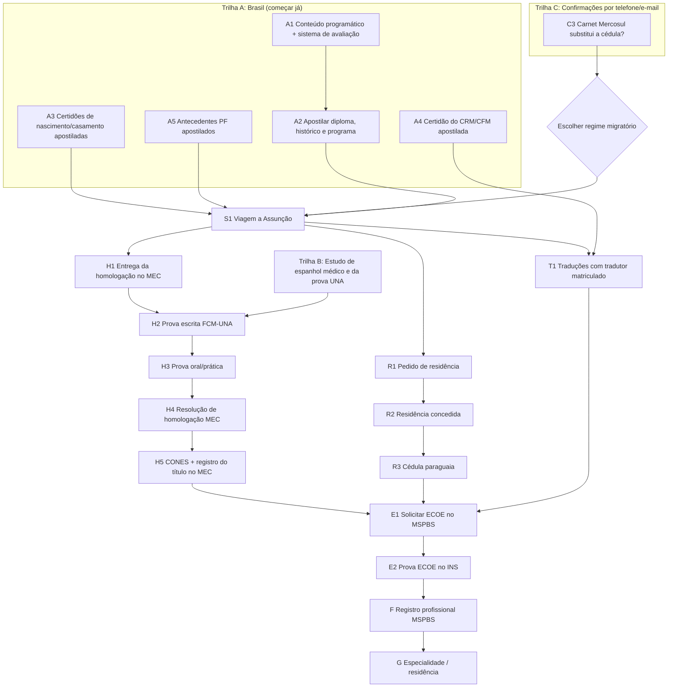

# Spec de ações: registro de médico no Paraguai

> Versão 1, 27/10/2026. Complementa o [guia detalhado](guia-exercicio-medicina.md), que traz as fontes de cada requisito.
> Objetivo: obter o **registro profissional do MSPBS**, que permite atender no Paraguai.
> Convenção: **[P]** = pode rodar em paralelo · **[S]** = sequencial, depende do item indicado · ⏱ = prazo · 💰 = custo.

## 1. Mapa de dependências

**Caminho crítico:** A1 → A2 → viagem → homologação MEC/UNA (H1 a H5) → ECOE → registro. A homologação é a etapa mais longa.

**Risco de segundo caminho crítico:** pela residência Mercosul, a cédula só sai com a permanente (~2 anos). Se for assim, a cédula passa a ser o gargalo. Por isso a confirmação C3 vem antes da viagem.

---

## 2. Trilhas paralelas: comece agora

### Trilha A: documentos no Brasil [P, todas juntas]

| ID | Ação | Onde | ⏱ | 💰 | Pronto quando |
|----|------|------|---|----|---------------|
| A1 | Pedir **conteúdo programático de todas as disciplinas** (páginas numeradas e autenticadas) e **declaração do sistema de avaliação** | Secretaria da sua faculdade | 2 a 8 semanas | Taxa da faculdade | Documentos em mãos, carimbados |
| A2 | Apostilar **diploma, histórico com carga horária e programa** [S: depende de A1 para o programa; diploma e histórico podem ir antes] | Cartório habilitado (CNJ) | 1 a 5 dias | ~R$ 130 a 150 por documento | Apostila colada em cada um |
| A3 | Tirar certidão de nascimento atualizada (e de casamento, se houver) e apostilar | Cartório de registro civil | 1 a 2 semanas | Certidão + apostila | Emitidas há menos de 6 meses |
| A4 | Certidão ético-profissional do **CRM** (e do CFM, se possível) e apostilar | CRM do seu estado | 1 a 2 semanas | Baixo | Original apostilado |
| A5 | Antecedentes criminais da **Polícia Federal** e apostilar. **Fazer por último**, até ~30 dias antes da viagem (valem ~90 dias) | gov.br + cartório | 1 a 3 dias | Gratuito + apostila | Dentro da validade na data da entrega |
| A6 | Conferir se o RG está legível e em bom estado. Passaporte é **opcional** | — | — | — | RG aceito para entrar e pedir residência |

### Trilha B: estudo [P, contínua]

| ID | Ação | ⏱ |
|----|------|---|
| B1 | Espanhol médico (anamnese, exame físico, prescrição, comunicação) | Desde já, até a prova |
| B2 | Revisão para a prova escrita da FCM-UNA (clínica, cirurgia, pediatria, GO, saúde pública). Nota mínima 70% | 3 a 6 meses |
| B3 | Treino de estações tipo OSCE para o ECOE (6 min por estação, 8 a 20+ estações) | Antes do ECOE |

### Trilha C: confirmações remotas [P, nas próximas 2 semanas]

| ID | Pergunta | Para quem | Por que importa |
|----|----------|-----------|-----------------|
| C1 | Taxas atuais de homologação e se o Brasil conta como "país com convênio" | VES/MEC, (021) 443040 | Pode reduzir as taxas em ~Gs. 3 milhões |
| C2 | Calendário da próxima prova de homologação de medicina | FCM-UNA | Define a data da viagem |
| C3 | O **carnet de residente Mercosul** substitui a cédula paraguaia no ECOE e no registro? | MSPBS (021 2374000, ramal 1300) e INS (mesadeentradains@gmail.com) | Decide o regime migratório |
| C4 | O reconhecimento do CONES é pedido junto ou depois da homologação? | CONES, (021) 450927 | Evita uma viagem extra |

**Decisão D (depois de C3):**
- Se o carnet Mercosul for aceito: **Residência Temporária Mercosul** (Gs. 2.341.540, mais simples).
- Se não for: **Residência Temporária Lei 6984/2022** (Gs. 2.926.925), que dá a cédula já na temporária.

---

## 3. Sequência principal

### S1. Viagem a Assunção (1 a 2 semanas)
**Depende de:** A2, A3, A5 e da decisão D. **Leve:** RG, todos os originais apostilados, cópias e o dinheiro das taxas.

Durante a mesma viagem, faça em paralelo:

| ID | Ação | Onde | 💰 |
|----|------|------|----|
| R1 | Tirar **antecedentes para estrangeiros** e protocolar o **pedido de residência**. A partir daqui você é "residente precário" e pode trabalhar | Polícia Nacional + Migraciones, Caballero 201, 7h às 14h30 | Gs. 2,3 a 2,9 milhões |
| H1 | Autenticar cópias em escrivania paraguaia e **protocolar a homologação** do diploma. Pagar as taxas do MEC e da UNA | VES/MEC, 15 de Agosto 629, 7h30 às 15h | Gs. 6 a 9 milhões (tabela de 2018) |
| T1 | Contratar **tradutor matriculado na Corte Suprema** para a certidão do CRM e os antecedentes do Brasil (exigidos pelo MSPBS) | Assunção | Por página |

### Trilha R: residência [S a partir de R1, roda em paralelo com H]

| ID | Ação | Depende de | ⏱ |
|----|------|-----------|---|
| R2 | Retirar o carnet de residente | R1 | 1 a 4 meses |
| R3 | Tirar a **cédula paraguaia** no Departamento de Identificaciones | R2 (no regime Mercosul, só após a permanente) | Semanas |
| R4 | (Só no regime Mercosul) Pedir a **permanente nos 90 dias antes do vencimento** do carnet. Perder esse prazo faz perder o direito | R2 | Lembrete no calendário |

### Trilha H: homologação [S, caminho crítico]

| ID | Ação | Depende de | ⏱ |
|----|------|-----------|---|
| H2 | **Prova escrita** na FCM-UNA (≥70%) | H1 + B2 | Conforme o calendário da UNA |
| H3 | **Prova oral/prática** (≥70%) | H2 aprovada | Semanas após H2 |
| H4 | Retirar a **Resolução de Homologação** do VES/MEC | H3 | Semanas |
| H5 | Reconhecimento do **CONES** + **registro do título** no MEC (6º andar) | H4 (ver C4) | ~5 dias úteis |

⏱ Total da trilha H: oficialmente ~3 meses; na prática, **6 a 18 meses**.

### Junção: ECOE e registro [S, só quando H5, R3 e T1 estiverem prontos]

| ID | Ação | Onde | Depende de | ⏱ | 💰 |
|----|------|------|-----------|---|----|
| E1 | Entregar os documentos e obter a **Solicitud de Evaluación de Competencias** | MSPBS, Brasil c/ Manuel Domínguez, 1º andar | H5 + R3 + T1 | Semanas | — |
| E2 | Inscrever-se no **ECOE** (≥15 dias úteis antes), ir à reunião informativa e fazer a prova | INS | E1 + B3 | Janelas em **abril, julho e novembro** | Taxa do INS |
| F | Protocolar o **registro profissional** com o resultado do ECOE e todos os documentos | MSPBS | E2 aprovada | Semanas | Gs. 110.000 |
| G | Registrar a especialidade / concorrer à residência (CONAREM) | MSPBS / CONAREM | F | Varia | Varia |

O registro vale **5 anos**. Coloque a renovação no calendário.

---

## 4. Cronograma de exemplo (começando em novembro de 2026)

| Período | O que acontece |
|---------|----------------|
| Nov/2026 a Jan/2027 | Trilha A (documentos), Trilha C (ligações), decisão D, início da Trilha B |
| Fev/2027 | Viagem a Assunção: R1, H1, T1 |
| Mar a Jun/2027 | Carnet de residente (R2). Estudo para a prova da UNA |
| Meados de 2027 | Provas da UNA (H2, H3), conforme o calendário |
| 2º semestre/2027 | Resolução de homologação, CONES e registro MEC (H4, H5). Cédula (R3), se o regime permitir |
| Nov/2027 ou Abr/2028 | ECOE (E2) |
| Até meados de 2028 | **Registro profissional no MSPBS (F)** |

Se a prova da UNA for reprovada, a Trilha H recomeça em H2 na próxima data, o que adia tudo depois dela.

## 5. Checklist desta semana

- [ ] Pedir à faculdade o conteúdo programático e a declaração do sistema de avaliação (A1)
- [ ] Pedir a certidão ético-profissional do CRM (A4)
- [ ] Pedir a certidão de nascimento atualizada (A3)
- [ ] Mandar e-mail ao INS e ligar para o MSPBS com a pergunta C3
- [ ] Ligar para o VES/MEC e para a FCM-UNA (C1, C2)
